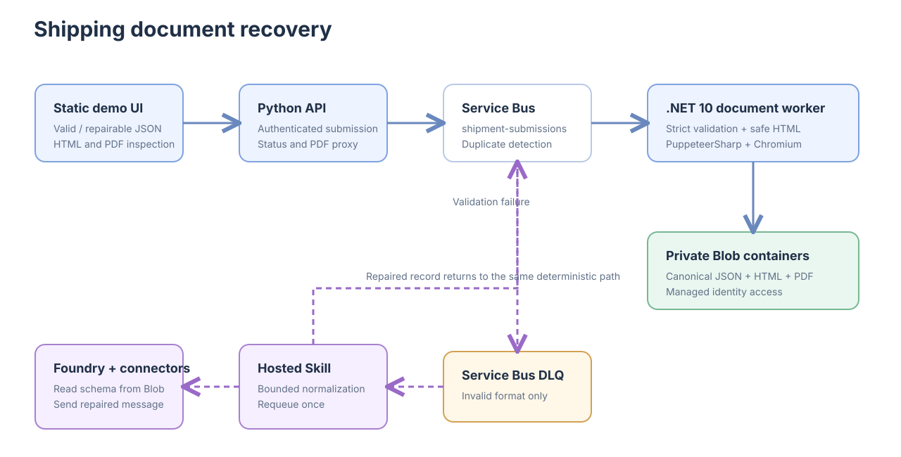

# Shipping document recovery with Azure Functions

This demo turns partner shipment JSON into a standardized packing-slip PDF.
It combines deterministic Azure Functions processing with a bounded Azure
Functions Hosted Skill for repairable formatting differences.

- A valid shipment goes from Service Bus to a .NET 10 worker container.
- The worker validates the record, creates safe HTML, renders it with
  PuppeteerSharp and OS-installed Chromium, and stores the canonical JSON,
  HTML, and PDF in Blob Storage.
- An invalid record reaches the Service Bus dead-letter queue (DLQ).
- A Markdown-defined Hosted Skill reads a compact repair contract through a
  Connector Namespace, normalizes only allowlisted formatting differences,
  and requeues the record once.
- The repaired record must pass the same deterministic .NET validation before
  any document is created.



> [!IMPORTANT]
> Azure Functions Registry-backed Flex Consumption containers, Hosted Skills,
> and Connector Namespace resources used by this sample are preview
> capabilities. The sample is designed for demonstrations and evaluation, not
> production shipping operations.

## Demo experience

The authenticated static UI provides two predefined records:

1. **Valid record** - generates the HTML and PDF directly.
1. **Repairable record** - uses camelCase field names, string numbers, a
   US-formatted date, lowercase country code, and uppercase service level.
   The .NET worker rejects it, Service Bus moves it to the DLQ, and the Hosted
   Skill normalizes and requeues it.

The UI shows:

- the submitted JSON;
- confirmed event stages;
- the canonical revalidated shipment;
- the exact sandboxed HTML sent to Chromium;
- a link to the PDF stored in the private Blob container;
- the architecture diagram.

## Architecture

| Component | Responsibility |
|---|---|
| Static Web App | Authenticated demo UI |
| Python Function App | Submission/status API and `shipment_repair.agent.md` |
| Service Bus | Primary queue, DLQ, duplicate detection, and event-driven delivery |
| .NET 10 Registry Function App | Strict validation, safe HTML generation, Chromium rendering, and Blob output |
| Connector Namespace | Repair-contract-read and repaired-message-send MCP tools |
| Microsoft Foundry | Model used by the Hosted Skill |
| Blob Storage | Deployment artifacts, schema, run state, canonical JSON, HTML, and PDF |
| Application Insights | Function, model, and tool telemetry |

Both Function Apps use the same user-assigned managed identity. ACR admin and
anonymous access are disabled. The document worker pulls through a
repository-scoped read-only token and is deployed by immutable image digest.

## Repair boundary

The Hosted Skill may only:

- rename documented camelCase fields to canonical snake_case;
- convert numeric strings to numbers;
- convert `MM/DD/YYYY` to `YYYY-MM-DD`;
- lowercase the service level;
- uppercase the country code.

It must not invent or remove business data. A message can be repaired only
once. Every repaired message returns to the primary queue and is revalidated by
the .NET worker.

## Prerequisites

- Git
- .NET 10 SDK
- Python 3.13
- Node.js 24
- Azure CLI
- Azure Developer CLI
- an Azure subscription enabled for the preview capabilities and regions
- permission to create resource groups, role assignments, Function Apps,
  Service Bus, storage, ACR, Static Web Apps, Connector Namespace resources,
  and Microsoft Foundry resources

Before provisioning, verify that the selected Foundry model and capacity are
available in `AZURE_LOCATION`. The Bicep defaults to `gpt-oss-120b` version `1`
with the `OpenAI-OSS` format and capacity `500`, which supports Foundry
`agentsV2`, chat completion, and tool use without requiring Azure OpenAI model
entitlement.

## Deploy

```shell
az login
azd auth login
azd env new shipping-doc-demo
azd env set AZURE_SUBSCRIPTION_ID <subscription-id>
azd env set AZURE_LOCATION westcentralus
azd env set AZURE_FUNCTION_LOCATION westcentralus
azd env set CONNECTOR_LOCATION westcentralus
azd env set AZURE_EXPERIENCE_LOCATION eastus2
azd env set FOUNDRY_MODEL gpt-oss-120b
azd env set FOUNDRY_MODEL_VERSION 1
azd env set FOUNDRY_MODEL_FORMAT OpenAI-OSS
azd env set FOUNDRY_MODEL_CAPACITY 500
azd up
```

The Function Apps, Service Bus, storage, ACR, Foundry, managed identity, and
Connector Namespace use West Central US. Static Web Apps and the monitoring
stack use East US 2 because those resource types are unavailable in West
Central US.

The first deployment intentionally leaves the demo API locked. Open
`<DEMO_URL>/.auth/me`, sign in, and copy its `userId`. Then configure that
exact owner and reapply the deployment:

```shell
azd env set DEMO_OWNER_ID <static-web-app-user-id>
azd up
```

If `DEMO_OWNER_ID` is empty, the demo API denies every submission.

The deployment:

1. provisions shared Azure resources;
1. uploads `src/shipment-schema.json`;
1. restores, tests, and publishes .NET locally;
1. stages only the published output and pinned runtime Dockerfile;
1. builds or reuses the Linux AMD64 image with ACR Tasks;
1. resolves and deploys an immutable manifest digest;
1. deploys the Python Hosted Skills app and static UI.

NuGet restore does not run inside Docker or ACR Tasks.

## Local validation

Use a .NET 10 SDK:

```shell
dotnet test ./tests/ShippingDocumentWorker.Tests/ShippingDocumentWorker.Tests.csproj --configuration Release
dotnet test ./infra/scripts/DeployHelper.Tests/DeployHelper.Tests.csproj --configuration Release
dotnet publish ./ShippingDocumentWorker.csproj --configuration Release --self-contained false
```

Validate the Python and frontend sources:

```shell
python -m compileall ./src ./scripts
python -m unittest discover -s ./tests/python
npm --prefix ./web run build
```

Compile the infrastructure and package the azd services:

```shell
az bicep build --file ./infra/main.bicep --stdout
az bicep build --file ./infra/document-worker.bicep --stdout
azd package --no-prompt
```

## Demo script

See [`docs/demo-script.md`](./docs/demo-script.md) for a focused five-minute
walkthrough.

## Security notes

- The UI and API require Microsoft sign-in and an exact configured owner ID.
- HTML is generated from validated structured data; arbitrary submitted HTML is
  never rendered.
- Customer-controlled strings are HTML-encoded.
- Chromium runs as a non-root user with its sandbox enabled.
- JavaScript and external resource requests are disabled during rendering.
- Storage and Service Bus use managed identity and have local-key
  authentication disabled.
- Blob containers are private.
- Connector MCP operations are scoped to one schema path and one queue.
- Repaired messages carry a marker and cannot enter a repair loop.

## Preview limitations

- The sample uses preview Azure resource APIs and prerelease packages.
- The .NET image is Linux AMD64.
- The ACR pull password is short-lived and refreshed by deployment.
- Model output is not deterministic. The .NET validator is the authority.
- A normally completed Hosted Skill invocation settles its DLQ message even
  when its response reports that repair was not possible. Do not send important
  production data through this demonstration.
- The storage endpoint is public, but data access requires Microsoft Entra
  authorization and shared-key access is disabled.

## Clean up

```shell
azd down --force
```

## License

This project is licensed under the [MIT License](./LICENSE).
